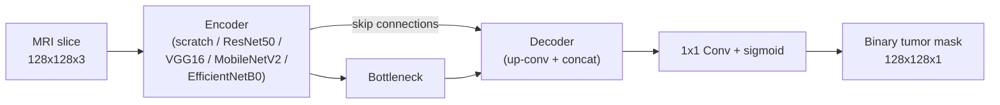
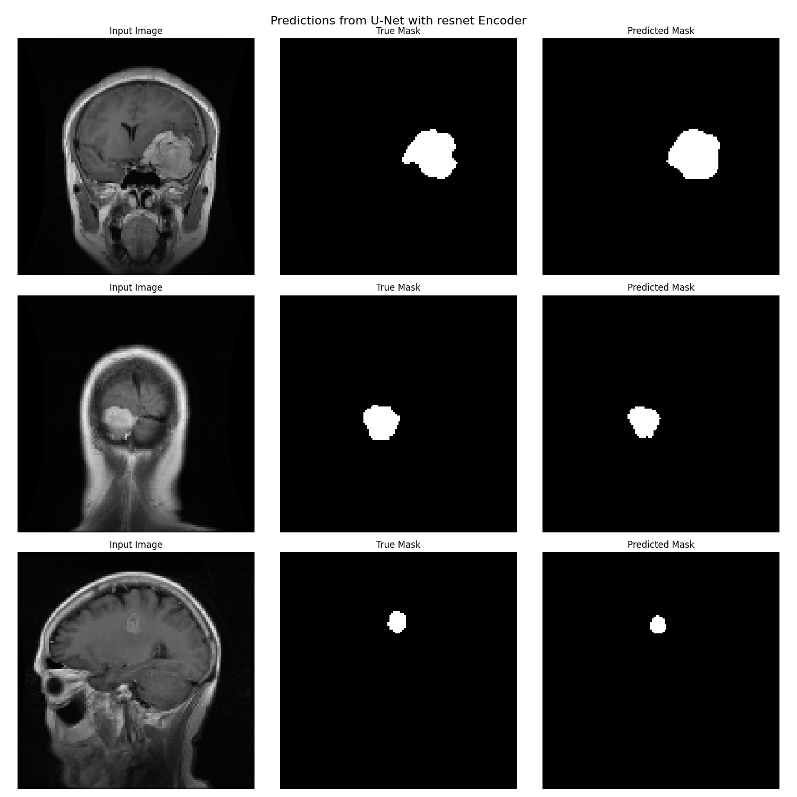
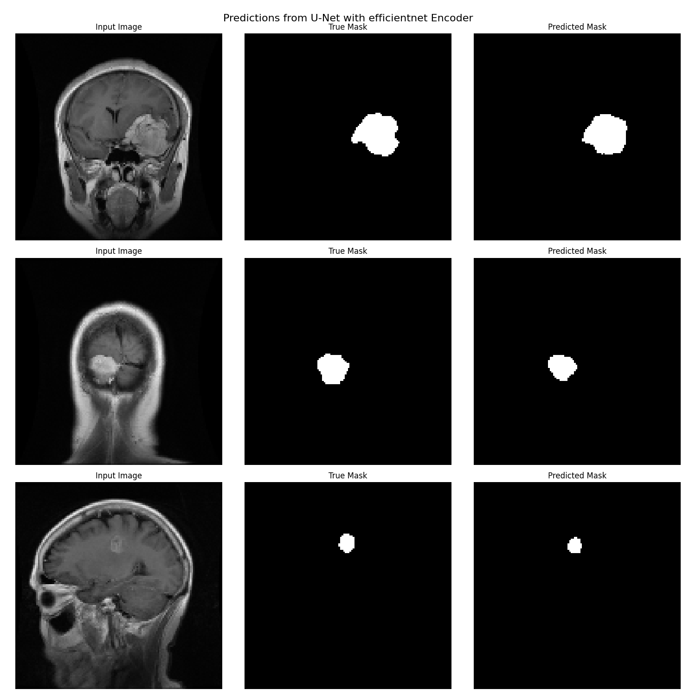
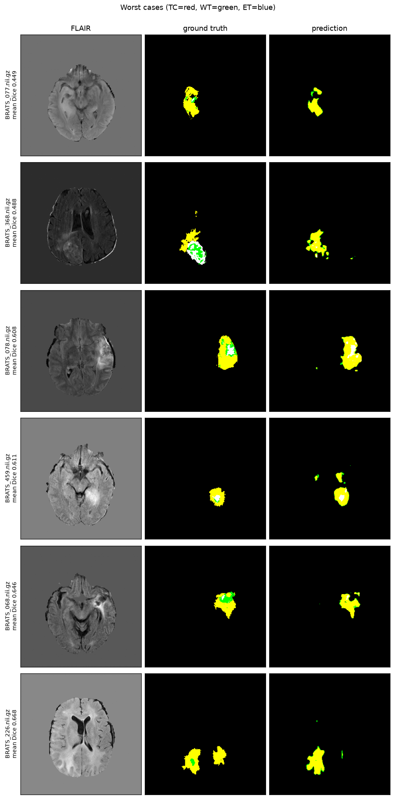
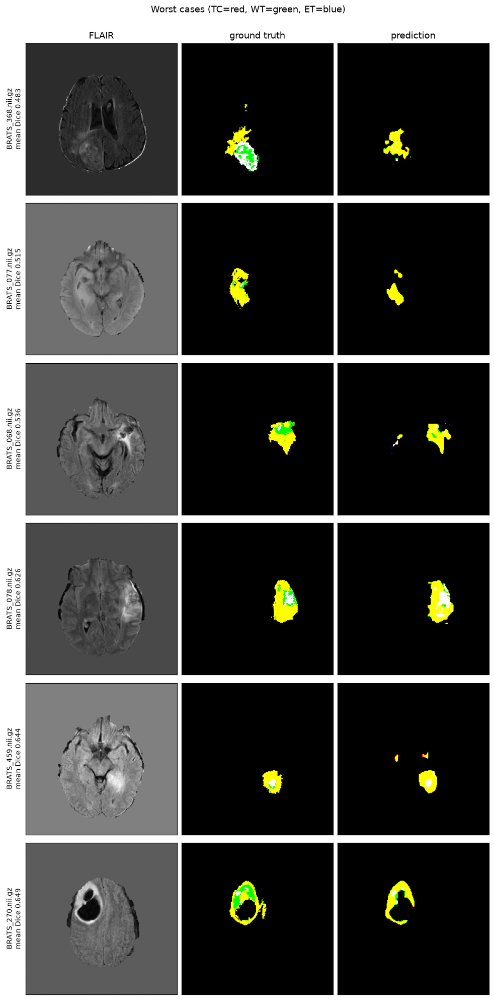

# Brain Tumor Segmentation using U-Net

[](https://github.com/AnikaSharma17/Brain-Tumor-Segmentation-Using-U-Net/actions/workflows/ci.yml)


[](LICENSE)

This project implements and compares four U-Net variants with pretrained encoder
backbones — **ResNet50**, **VGG16**, **MobileNetV2**, and **EfficientNetB0** — to
segment brain tumors from 2D MRI slices.

It also includes a **3D extension** that segments whole MRI volumes with a 3D U-Net
and SegResNet on the BraTS dataset (PyTorch + MONAI) — a separate, self-contained
stack that adds true volumetric context. See the
[3D extension](#3d-extension--volumetric-brats-segmentation-pytorch--monai) section
below.

---

## Objective

- Segment brain-tumor regions from MRI slices.
- Compare the four pretrained encoder backbones inside a shared U-Net decoder.
- Evaluate with segmentation-appropriate metrics on a held-out test set.

---

## Dataset

- **Source**: Figshare brain-tumor MRI dataset — 2D grayscale slices with binary
  tumor masks. (Not BRATS.)
- **Size**: 3,064 image/mask pairs.
- **Structure**:
  - Images: `image_dataset/images/`
  - Masks:  `image_dataset/masks/`  (binary, 0/255)
- **Loaded resolution**: 128×128.
- **Preprocessing** (see `src/brain_tumor_segmentation/data.py`):
  - Images are decoded as 3-channel (the single grayscale channel is replicated so
    the ImageNet-pretrained encoders can be used) and kept in `[0, 255]`; the
    correct per-encoder `preprocess_input` is applied **inside each model**.
  - Masks are resized with **nearest-neighbour** interpolation and re-binarized to
    `{0, 1}` (bilinear resizing would corrupt the labels at tumor boundaries).
  - Images and masks are paired explicitly by filename.
- **Split**: disjoint train / validation / test (≈70 / 15 / 15) with a fixed seed.
  > Note: filenames do not expose patient IDs, so this is a **slice-level** split.
  > Slices from the same patient may land in different splits; use a patient-grouped
  > split if patient IDs become available.
- **Augmentation** (training set only): random horizontal/vertical flips, 90°
  rotations, and additive Gaussian noise (geometric transforms are applied
  identically to image and mask).

---

## Architecture

- **Base**: U-Net (encoder–decoder with skip connections).
- **Encoders**: ResNet50, VGG16, MobileNetV2, EfficientNetB0 (ImageNet weights).
- **Output**: single-channel sigmoid mask at 128×128.
- **Loss**: combined binary cross-entropy + Dice (handles the small-foreground
  class imbalance).

---

## Metrics

- Dice Coefficient, Precision, Recall, Binary IoU (thresholded at 0.5), and pixel
  accuracy. Dice and IoU are the primary segmentation metrics; pixel accuracy is
  reported for reference but is inflated by the large background class.

---

## Project structure

```
.
├── src/brain_tumor_segmentation/   # importable package
│   ├── config.py          # paths & hyperparameters (env-overridable)
│   ├── data.py            # pairing, disjoint split, augmentation
│   ├── model.py           # U-Net: from-scratch baseline + 4 encoder backbones
│   ├── losses.py          # BCE + Dice loss
│   ├── metrics.py         # Dice coefficient
│   ├── inference.py       # load model + predict on a single image
│   └── visualization.py   # prediction grids & training curves
├── src/bts3d/             # 3D track package (PyTorch + MONAI)
│   ├── config.py          # paths & hyperparameters (env-overridable)
│   ├── data.py            # MONAI transforms, patient-level split, loaders
│   └── model.py           # 3D U-Net / SegResNet builders
├── scripts/
│   ├── train.py           # train + evaluate all models
│   ├── retrain.py         # retrain selected model(s), with LR-schedule options
│   ├── evaluate.py        # per-image Dice distribution + error analysis
│   ├── advanced_eval.py   # test-time augmentation (TTA) + model ensembling
│   ├── plot_results.py    # bar charts from results spreadsheet
│   ├── visualize_models.py# prediction grids from saved models
│   ├── predict.py         # CLI: predict a mask for one image (optional --tta)
│   ├── app.py             # optional Gradio demo
│   ├── sanity_3d.py       # 3D: dataset download + GPU/data sanity check
│   ├── train_3d.py        # 3D: train U-Net / SegResNet (AMP, sliding-window val)
│   └── evaluate_3d.py     # 3D: test-set Dice + Hausdorff95 + worst-case gallery
├── notebooks/             # inference_demo.ipynb (load model + predict + overlay)
├── tests/                 # pytest suite
├── assets/                # sample prediction grids shown in this README
├── .github/workflows/     # CI (ruff + pytest)
├── image_dataset/{images,masks}/
├── outputs/               # 2D artifacts, generated at runtime (git-ignored)
├── outputs_3d/            # 3D checkpoints & galleries (git-ignored)
├── Dockerfile             # CPU training/inference image
├── pyproject.toml         # packaging + dependencies
├── requirements.txt       # 2D (TensorFlow); requirements-3d.txt for the 3D track
├── LICENSE
└── .env.example           # optional config overrides
```

---

## Architecture diagram



Per-encoder ImageNet preprocessing is applied **inside** each model, so a saved
model is self-contained for inference. The from-scratch U-Net is the baseline the
pretrained backbones are compared against.

---

## Setup

```bash
python -m venv .venv
.venv\Scripts\activate        # Windows  (source .venv/bin/activate on macOS/Linux)
pip install -e .              # installs the package + dependencies
```

- Python 3.9–3.11, TensorFlow 2.15 (Keras 2).
- **GPU note:** TF ≥ 2.11 has no native Windows GPU support, so training runs on
  **CPU** on native Windows. For GPU use WSL2, or Python 3.10 + TensorFlow 2.10.
- Optional: copy `.env.example` to `.env` to override paths or hyperparameters.

## Running

```bash
python scripts/train.py            # train + evaluate all 5 models (scratch + 4 encoders)
python scripts/retrain.py --model efficientnet        # retrain one model (or several, or all)
python scripts/retrain.py --model resnet --lr-schedule cosine --epochs 30
python scripts/evaluate.py         # per-image Dice distribution + error analysis
python scripts/advanced_eval.py    # test-time augmentation (TTA) + model ensembling
python scripts/plot_results.py     # bar charts from the results spreadsheet
python scripts/visualize_models.py # prediction grids from saved models
python scripts/predict.py --model outputs/models/unet_resnet_model.keras \
    --image image_dataset/images/1.png --out prediction.png [--tta]  # single-image inference
```

`scripts/retrain.py` retrains only the model(s) you name (`--model all` for every one),
updating just their artifacts and spreadsheet rows; `--lr-schedule {none,cosine,plateau}`
and `--epochs` tune the run. `scripts/advanced_eval.py` reports Dice with/without TTA and
for an ensemble of the strongest models — both are inference-only (no retraining).

All artifacts are written under `outputs/` (git-ignored):
- `outputs/model_comparison_results.xlsx` — per-model test metrics.
- `outputs/models/` — trained `.keras` models.
- `outputs/predictions/` — prediction grids.
- `outputs/training_history/` — per-model training curves and CSV logs.
- `outputs/graphs/` — metric comparison bar charts.
- `outputs/evaluation/` — per-image Dice histograms, summary CSV, and TTA/ensemble results.

> Note: No results are committed to the repo. Run `scripts/train.py` to generate honest,
> held-out results into `outputs/`.

## Results

Metrics below are from one run of `scripts/train.py` on the **held-out test set**
(459 slices) with the default config (128×128 input, batch size 8, 20 epochs, seed 42,
CPU). `scripts/train.py` writes them to `outputs/model_comparison_results.xlsx`; your
own run may differ slightly. Dice and Binary IoU are the primary segmentation metrics;
pixel accuracy is reported for reference but is inflated by the large background class.

| Model                  | Dice      | Binary IoU | Precision | Recall | Pixel Acc. |
| ---------------------- | :-------: | :--------: | :-------: | :----: | :--------: |
| U-Net + ResNet50       | **0.790** | **0.831**  |   0.839   | 0.766  |   0.993    |
| U-Net + EfficientNetB0 |   0.790   |   0.830    |   0.829   | 0.774  |   0.993    |
| U-Net + VGG16          |   0.777   |   0.821    |   0.837   | 0.743  |   0.993    |
| U-Net (scratch)        |   0.729   |   0.791    |   0.683   | 0.815  |   0.990    |
| U-Net + MobileNetV2    |   0.725   |   0.789    |   0.758   | 0.722  |   0.991    |

Both pretrained top performers (ResNet50 and EfficientNetB0) clearly beat the
from-scratch baseline. EfficientNetB0 requires its encoder BatchNorm layers to be
frozen during fine-tuning (handled automatically in `model.build_encoder`); without
this it converges on the training set but collapses to all-background at inference.

### Per-image Dice distribution

Per-image hard-Dice over the test set (`scripts/evaluate.py`, which also writes
per-model histograms and `per_image_dice_summary.csv` under `outputs/evaluation/`).
The median sits well above the mean for every model: typical slices score highly, with
a tail of hard cases (tiny or faint tumors, some scoring 0) pulling the mean down.

| Model                  | Mean  | Median | Std   | P10 (worst 10%) |
| ---------------------- | :---: | :----: | :---: | :-------------: |
| U-Net + ResNet50       | 0.761 | 0.866  | 0.262 |      0.336      |
| U-Net + EfficientNetB0 | 0.756 | 0.856  | 0.257 |    **0.382**    |
| U-Net + VGG16          | 0.732 | 0.851  | 0.280 |      0.235      |
| U-Net (scratch)        | 0.708 | 0.816  | 0.273 |      0.275      |
| U-Net + MobileNetV2    | 0.681 | 0.809  | 0.309 |      0.011      |

ResNet50 has the best average, while EfficientNetB0 is the most consistent (lowest
variance and the strongest worst-10% performance). MobileNetV2 is the least reliable:
a decent median but its worst slices are near-total misses.

### Test-time augmentation & ensembling

Two inference-only ways to improve accuracy without retraining, via
`scripts/advanced_eval.py` (per-image Dice on the test set):

| Configuration                          |  Mean | Median |  P10  |
| -------------------------------------- | :---: | :----: | :---: |
| **Ensemble (ResNet + EfficientNet + VGG)** | **0.767** | 0.868  | 0.366 |
| ResNet50 (best single model)           | 0.757 | 0.862  | 0.337 |
| ResNet50 + TTA                         | 0.756 | 0.873  | 0.314 |
| Ensemble + TTA                         | 0.760 | 0.872  | 0.276 |

**Ensembling** (averaging the three strongest models' probability maps) is the clear
win: **+1.1 Dice points over the best single model, with no retraining**. **TTA**
(averaging over the eight D4 symmetries) reliably raises the *median* — typical slices
sharpen — but slightly lowers the *mean* and worst-10%, so on this dataset it is not
worth it, alone or on top of the ensemble. Use `scripts/predict.py --tta` to try it on
a single image.

### Model card (summary)

- **Task**: binary semantic segmentation of brain-tumor regions in 2D MRI slices.
- **Input**: single MRI slice, resized to 128×128 and replicated to 3 channels.
- **Output**: a 128×128 binary tumor mask (per-pixel sigmoid, thresholded at 0.5).
- **Training data**: Figshare brain-tumor MRI dataset (3,064 slices), slice-level
  train/val/test split with a fixed seed.
- **Intended use**: research and educational demonstration of encoder-backbone
  comparison for medical image segmentation.
- **Not for clinical use**: slice-level split (possible residual patient leakage),
  2D-only (no volumetric context), and no external/clinical validation. See
  [Limitations](#limitations).

## Tests & demo

```bash
pip install -e ".[dev]"   # pytest + ruff
pytest                    # unit tests (metrics, losses, split, model shapes)
ruff check .              # lint

pip install -e ".[demo]"  # gradio
python scripts/app.py --model outputs/models/unet_resnet_model.keras   # web demo
```

CI (`.github/workflows/ci.yml`) runs ruff + pytest on push/PR across Python 3.10–3.11.

## Docker

```bash
docker build -t brain-tumor-seg .
docker run --rm -v "$(pwd)/image_dataset:/app/image_dataset" \
    -v "$(pwd)/outputs:/app/outputs" brain-tumor-seg
```

---

## Limitations

- **Slice-level split, not patient-level.** Filenames expose no patient IDs, so
  slices from one patient may fall across splits; some residual leakage is possible.
- **CPU-only on native Windows** with TensorFlow 2.15 (see GPU note above).
- **2D only** — each slice is segmented independently; no 3D volumetric context.
- Pixel accuracy is reported but is inflated by the large background class; rely on
  Dice and IoU.

---

## Visualizations

Each prediction grid shows, for several held-out slices, the input MRI, the
ground-truth tumor mask, and the model's predicted mask. These are from the two
best models (sample runs; regenerate your own with `scripts/visualize_models.py`).

**U-Net + ResNet50**



**U-Net + EfficientNetB0**



---

## 3D extension — volumetric BraTS segmentation (PyTorch + MONAI)

Beyond the 2D slice models above, the project includes a **3D track** that segments
whole MRI volumes, giving the network true volumetric context. It is a separate,
self-contained stack (PyTorch + MONAI) under `src/bts3d/` and `scripts/*_3d.py`; the
2D TensorFlow project is unchanged.

### Dataset & task

- **Source**: Medical Segmentation Decathlon **Task01_BrainTumour** (BraTS) — 484
  multi-modal cases.
- **Input**: 4 co-registered MRI modalities per case (FLAIR, T1w, T1Gd, T2w).
- **Output**: the three overlapping BraTS sub-regions — **TC** (tumor core),
  **WT** (whole tumor), **ET** (enhancing tumor).
- **Split**: genuine **patient-level** ≈70 / 15 / 15 — each case is one patient, so
  there is no cross-split leakage (unlike the 2D track's slice-level split).
- **Pipeline** (`src/bts3d/data.py`): resample to 1 mm isotropic, per-channel z-score
  normalization, random 96³ patches for training; sliding-window inference at test time.

### Models

Two 3D baselines sharing the pipeline (`src/bts3d/model.py`): a plain 3D **U-Net** and
**SegResNet**, trained with Dice-Focal loss + cosine LR decay, mixed precision (AMP),
96³ patches, 100 epochs.

### Results — held-out test set (72 patients)

Per-region Dice and Hausdorff95 (HD95, lower is better, in voxels at 1 mm spacing),
from `scripts/evaluate_3d.py`:

| Region           | U-Net Dice | SegResNet Dice | U-Net HD95 | SegResNet HD95 |
| ---------------- | :--------: | :------------: | :--------: | :------------: |
| WT (whole tumor) |   0.872    |   **0.882**    |    19.4    |    **15.8**    |
| TC (tumor core)  |   0.813    |   **0.830**    |  **16.3**  |      16.3      |
| ET (enhancing)   |   0.797    |   **0.800**    |  **10.7**  |      12.7      |
| **Mean**         |   0.827    |   **0.837**    |    15.8    |    **15.0**    |

**SegResNet is the stronger model** — higher Dice on every region (mean 0.837 vs 0.827)
and tighter boundaries overall (mean HD95 15.0 vs 15.8).

> **Label-convention gotcha.** MSD Task01 encodes the enhancing tumor as label **3**,
> but MONAI's `ConvertToMultiChannelBasedOnBratsClassesd` defaults to `et_label=4`
> (BraTS 2018–2022). The transforms in `src/bts3d/data.py` pass `et_label=3` explicitly;
> without it the ET channel is empty and TC/WT silently drop the enhancing voxels, which
> makes ET Dice read as a spurious 0.

### Running the 3D track

```bash
# Install PyTorch first, from the CUDA index matching your GPU (cu128 shown, for the
# RTX 50-series / sm_120); then the rest:
pip install torch --index-url https://download.pytorch.org/whl/cu128
pip install -r requirements-3d.txt

python scripts/sanity_3d.py --download                 # fetch MSD Task01 + GPU/data check
python scripts/train_3d.py --model unet --epochs 100
python scripts/train_3d.py --model segresnet --epochs 100
python scripts/evaluate_3d.py --model segresnet \
    --checkpoint outputs_3d/models/bts3d_segresnet_best.pt   # Dice + HD95 + gallery
```

Artifacts land under `outputs_3d/` (git-ignored): `models/*.pt` checkpoints and
`test_worst_*.png` galleries.

- **GPU required.** The 3D track needs a CUDA GPU (developed on an RTX 5060 Laptop,
  8 GB, compute capability sm_120 → cu128 wheels). Unlike the 2D track, it does **not**
  run on CPU-only in a reasonable time.

### 3D visualizations

Worst-6 test cases per model — ground truth vs prediction on the axial slice with the
most tumor, overlaid as **TC = red, WT = green, ET = blue** (regenerate with
`scripts/evaluate_3d.py`).

**3D U-Net**



**SegResNet**


